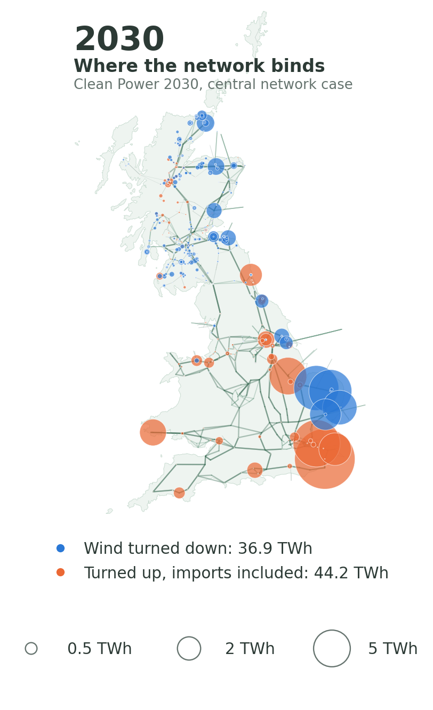
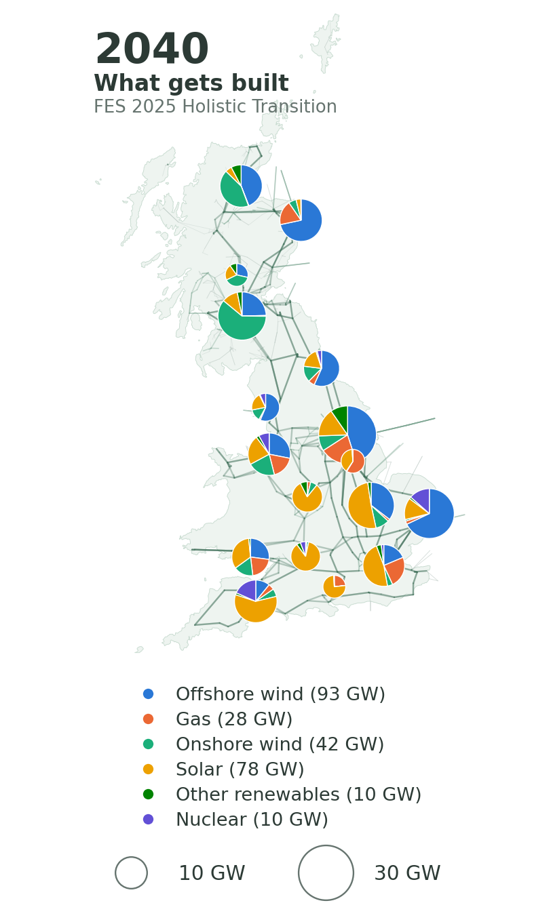
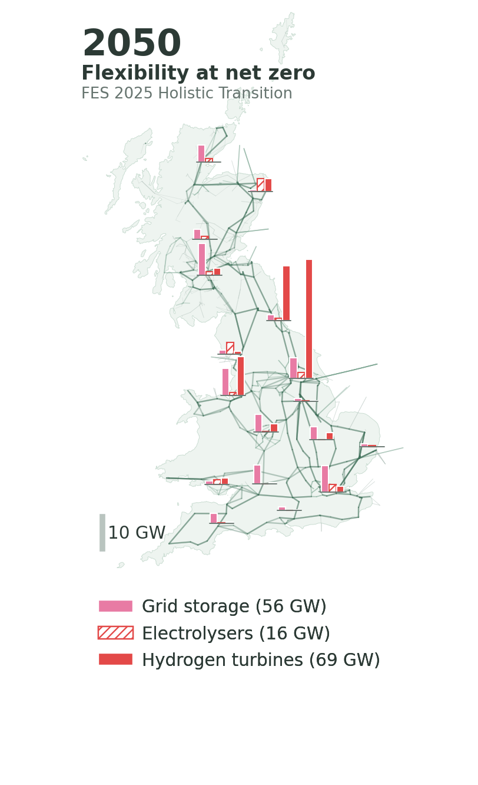

# PyPSA-GB

PyPSA-GB is an open-source model of Great Britain's electricity system, built on
[PyPSA](https://pypsa.org) and run as a [Snakemake](https://snakemake.readthedocs.io) workflow. It represents the
transmission network in detail, from the full ETYS network with its boundary limits to reduced and clustered
versions, and dispatches it either in a single network-constrained solve or as a two-stage market: wholesale trading
followed by the balancing mechanism. Scenarios cover historical years and NESO's Clean Power 2030 and Future Energy
Scenarios.

| 2030: where the network binds | 2040: what gets built | 2050: flexibility at net zero |
|---|---|---|
|  |  |  |

**Documentation: [pypsa-gb.readthedocs.io](https://pypsa-gb.readthedocs.io)**

## What it does

- **Network:** the full ETYS transmission network (about 2,400 buses), a Reduced 32-bus network or a Zonal network,
  optionally clustered; ETYS Appendix B upgrades by year, seasonal line ratings, secured boundary limits with
  NESO's outage pattern, and network-delivery cases.
- **Supply and demand:** DUKES, REPD and ESPENI for historical years; NESO Clean Power 2030 and FES for future
  years, placed on the network site by site or by grid supply point; storage, hydrogen and interconnectors.
- **Dispatch:** a single least-cost network-constrained solve, or a two-stage market: a GB wholesale market
  (copperplate), then the balancing mechanism on the real network, with bids and offers that reflect CfD, RO and
  merchant support, interconnector re-trading and a central-dispatch alternative.
- **Studies** (in `config/studies/`): Clean Power 2030 network constraints and balancing costs, FES 2025 Holistic
  Transition 2040 and 2050, the 2020 validation year, and research layers for household bills and public
  ownership.

## Quick start

```bash
# The repository history is large: a blob-less clone downloads file contents only as needed
git clone --filter=blob:none https://github.com/andrewlyden/PyPSA-GB.git
cd PyPSA-GB

conda env create -f envs/pypsa-gb-stable.yaml
conda activate pypsa-gb-stable

snakemake -n          # dry run: the default runs Test_Market, six hours of 2035 on the Reduced network
snakemake --cores 4   # build and solve it (wholesale market, then balancing mechanism)
```

`config/config.yaml` says what to run and which studies to load; `config/scenarios.yaml` holds the canonical
scenarios. Gurobi is the default solver and HiGHS the open-source alternative. Weather cutouts and some NESO
documents are downloaded by the workflow when first needed. See
[Getting Started](https://pypsa-gb.readthedocs.io/en/latest/getting_started/index.html).

## Citation

If you use PyPSA-GB in your research, please cite (see also `CITATION.cff`):

**Lyden, A., Sun, W., Struthers, I., Franken, L., Hudson, S., Wang, Y. and Friedrich, D., 2024.** PyPSA-GB: An
open-source model of Great Britain's power system for simulating future energy scenarios. *Energy Strategy
Reviews*, 53, p.101375. [doi:10.1016/j.esr.2024.101375](https://doi.org/10.1016/j.esr.2024.101375)

## Papers using PyPSA-GB

- **Dergunova, T. and Lyden, A., 2024.** Great Britain's hydrogen infrastructure development—Investment priorities
  and locational flexibility. *Applied Energy*, 375, p.124017.
- **Desguers, T., Lyden, A. and Friedrich, D., 2024.** Integration of curtailed wind into flexible electrified
  heating networks with demand-side response and thermal storage: Practicalities and need for market mechanisms.
  *Energy Conversion and Management*, 304, p.118203.
- **Lyden, A., Alene, S., Connor, P., Renaldi, R. and Watson, S., 2024.** Impact of locational pricing on the roll
  out of heat pumps in the UK. *Energy Policy*, 187, p.114043.
- **Lyden, A., Sun, W., Friedrich, D. and Harrison, G., 2023.** Electricity system security of supply in Scotland.
  Study for the Scottish Government via ClimateXChange.

## Licence and data

PyPSA-GB is released under the MIT licence. Input data keep their own licences and attributions; see
[Data licences and attribution](https://pypsa-gb.readthedocs.io/en/latest/reference/licences.html). What changed in
this version: [release notes](https://pypsa-gb.readthedocs.io/en/latest/development/release_notes.html).
